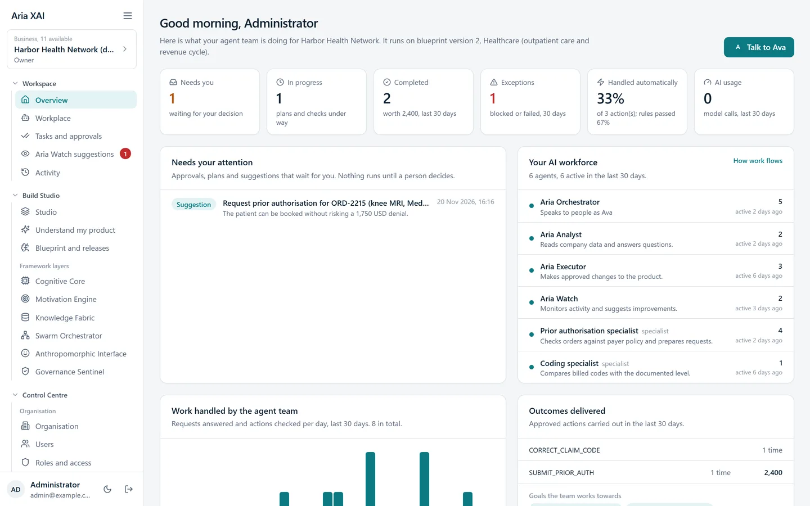
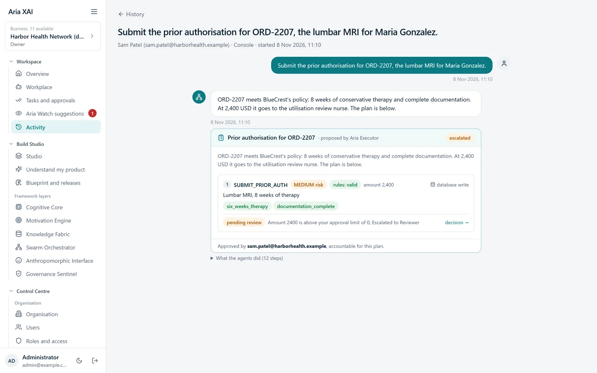
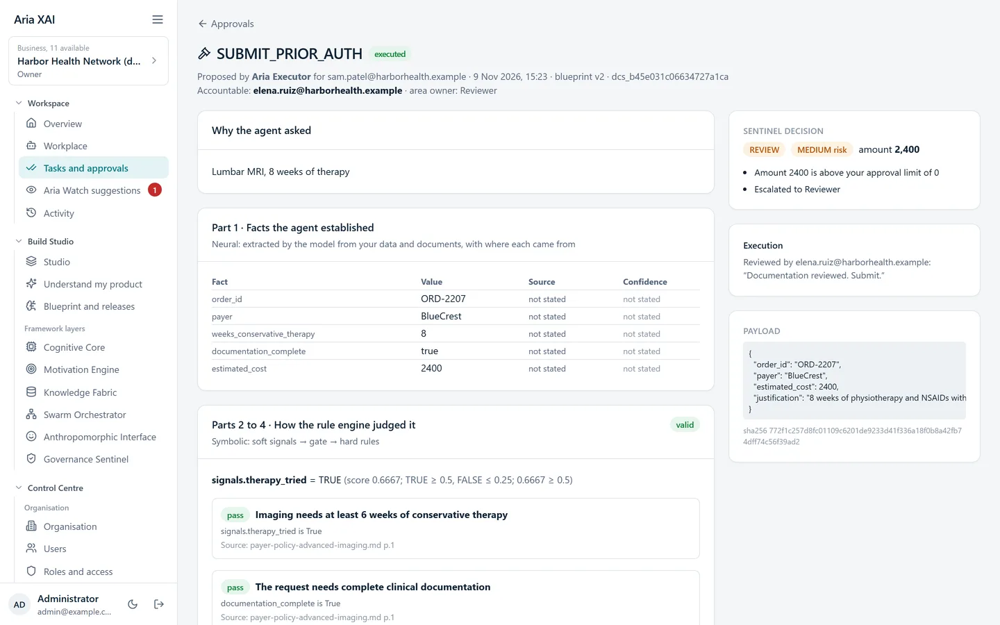
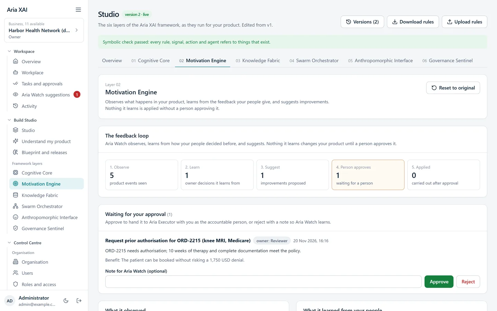
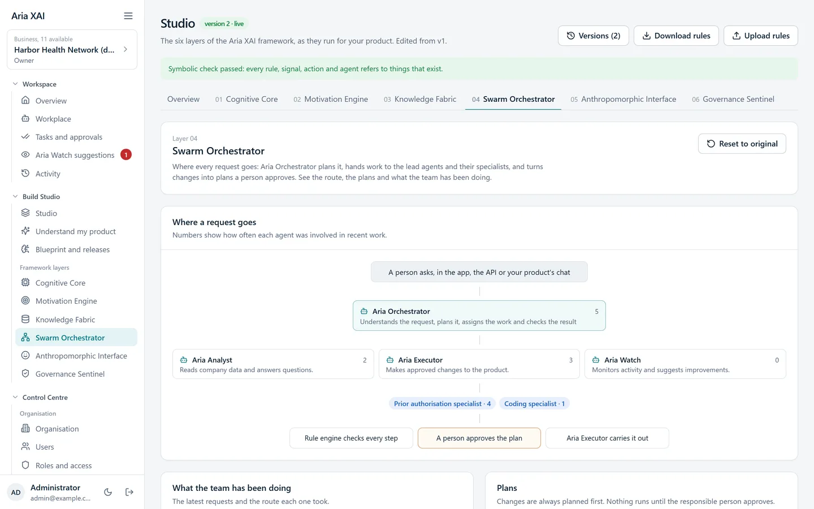
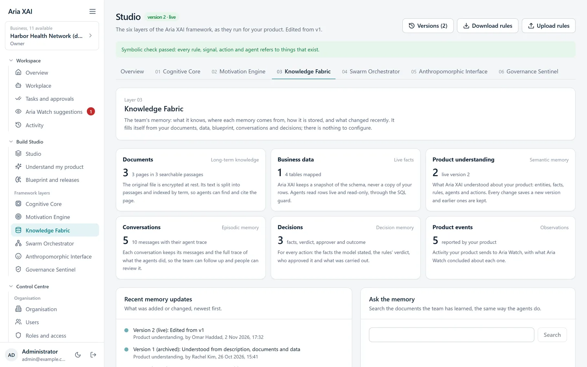
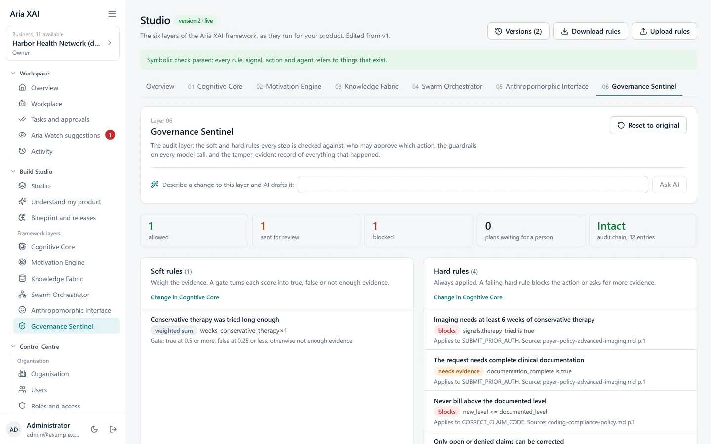

# Aria XAI

**Turn any product into a governed team of AI agents.** The AI proposes, the rules decide, and a named person approves every change.

A business describes its product, uploads its documents and connects its data. Aria XAI works out what the business is (there is no
industry to pick), proposes an agent team, the rules that govern it and the actions it may take, and a person reviews and publishes it.
The team then works in the app, through an API, or as a chat widget inside the business's own product.

[](https://codespaces.new/Adarsh2804-stack/aria-xai?quickstart=1)



## See it running

The quickest way is a Codespace: it installs everything, loads nine demo businesses with weeks of history, and starts the app.

1. Click **Open in GitHub Codespaces** above and wait for the setup to finish (a few minutes the first time).
2. Open port **8700** from the **Ports** tab. The terminal prints your demo login: username `admin` and a password made for your Codespace.
3. Sign in, pick a business, and explore. Every screen works on the demo data.

Talking live to the agent team needs an AI model key. Add a [Codespaces secret](https://docs.github.com/en/codespaces/managing-your-codespaces/managing-your-account-specific-secrets-for-github-codespaces)
named `ARIAX_LLM_API_KEY` (an Anthropic key) before you create the Codespace. Without it, everything else still works.

## Demo businesses

One login, `admin`, is Owner of all of them. Each has documents, a database, a published blueprint, a team in every role, conversations,
decisions, Aria Watch events and a verified audit log.

| Vertical | Business | The agent team |
|---|---|---|
| Healthcare | Harbor Health Network | Prior authorisation against payer policy, coding that never exceeds the documentation |
| Financial services | Northstar Wealth Partners | Reg BI suitability and cost checks, rebalancing on drift |
| Industrial AI | Ironvale Manufacturing | Maintenance from telemetry, approved-supplier reorders, the process happy path |
| Robotics and physical AI | Kinetiq Robotics | Missions within battery, payload and zone limits; autonomy earned by safety record |
| Property tech | Cedarline Residential | Fair Housing screening, renewals within the rent cap, licensed vendors |
| Commodities and markets | Atlas Commodities Trading | Sanctions, KYC and credit limits before every trade |
| Retail, dental, freight | Peak Outdoor Gear, Lumen Dental Clinics, Brightline Freight | Refunds and stock, deposits and waiting lists, late-delivery credits |

## The product

| | |
|---|---|
|  |  |
| **Workplace.** A persona speaks for the business; behind it the orchestrator plans, delegates and turns changes into plans a person approves. | **Every decision explained.** The facts the model stated, each rule's verdict with its source page, the accountable person, the payload hash. |
|  |  |
| **Motivation Engine.** Observe, learn from people's feedback, suggest; nothing changes without approval. | **Swarm Orchestrator.** Where each request went, the plans, and what the team has been doing. |
|  |  |
| **Knowledge Fabric.** The team's memory: what it knows, how it is stored, what changed. | **Governance Sentinel.** Soft and hard rules, approval policy, guardrails, kill switch and the audit trail. |

The app has three areas, each shown to the roles that may use it:

- **Workspace:** Command Centre, Workplace (chat with the agent team), tasks and approvals, Aria Watch suggestions, activity.
- **Build Studio:** understand my product, blueprint and releases, and the six framework layers (Cognitive Core, Motivation Engine,
  Knowledge Fabric, Swarm Orchestrator, Anthropomorphic Interface, Governance Sentinel).
- **Control Centre:** organisation and go-live setup, users, roles and access, API and chat widget, audit log, usage.

## How it decides

1. The model reads the request, documents and data and **states facts** with their source.
2. **Soft signals** weigh the evidence; a **gate** turns each score into true, false or not enough evidence.
3. **Hard rules** (written from the business's own documents, with citations) return valid, invalid or not enough evidence.
4. **Sentinel policy** checks the step against the accountable person's authority: allow, review or block.
5. A **person approves**, and is recorded as accountable. Only then Aria Executor carries it out, by webhook or a scoped database write.
6. Everything is written to a **hash-chained audit log**.

## Run it on your own machine

Requirements: Python 3.13 and Node 22.

```bash
pip install -r backend/requirements.txt
cd frontend && npm ci && npm run build && cd ..
ARIAX_DEMO_PASSWORD=choose-one python scripts/seed_demo.py
python -m uvicorn app.main:app --app-dir backend --port 8700
```

Open http://localhost:8700 and sign in as `admin` with the password you chose. To talk to the agents, set `ARIAX_LLM_API_KEY`
(and optionally `ARIAX_LLM_PROVIDER`, `ARIAX_LLM_MODEL`) before starting the server. The AI model is configured on the server only;
there is no screen for it in the app.

## Deploy

`Dockerfile` and `docker-compose.yml` build one container that serves the API and the web app. Set `ARIAX_MASTER_KEY` (encrypts
every stored secret), `ARIAX_BASE_URL` and `ARIAX_LLM_API_KEY`, and put HTTPS in front of port 8700. `scripts/make_deploy.py` builds a
single deploy zip with the demo data and a step-by-step `DEPLOY.md`.

## Tech

FastAPI, SQLAlchemy 2 and SQLite (or Postgres), React 19 with Vite and Tailwind, and a rule engine (`ariax/`) for the symbolic part.
Secrets are encrypted at rest, passwords are stored only as salted scrypt hashes, and API keys are never sent to the browser.

```bash
python -m pytest backend/tests -q   # product tests
python -m pytest tests -q           # rule engine tests
```

All demo data is synthetic. Names, companies and records are invented.
